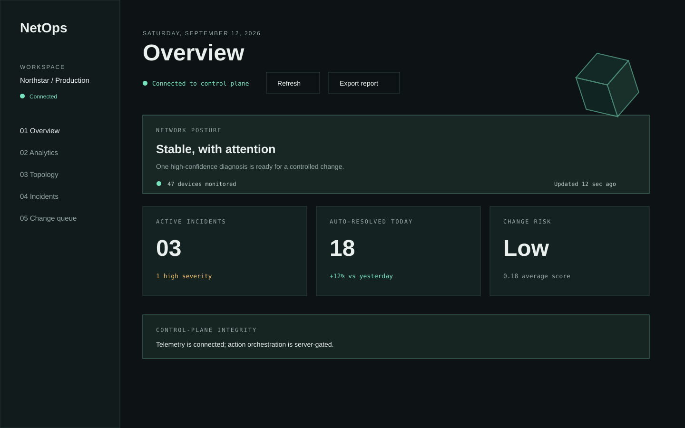

# Netops task assessment for Cisco Community (2026),VIT Bhopal

Netops is a control-room prototype for the Cisco Community VIT Bhopal 2026 task assessment. It detects network faults, explains likely root causes, plans safe changes, simulates their impact, and records operator decisions.



## What It Includes

- Authenticated control-room dashboard with Overview, Analytics, Topology, Incidents, and Change Queue views.
- SQLite-backed Python API with sessions, telemetry, incidents, analyst notes, and audit events.
- Detect -> Understand -> Plan -> Evaluate -> Decide -> Simulated Apply lifecycle modules.
- Safety simulation and approval gates; device operations are simulated only.
- Scroll-driven topology cube and a tokenized, gradient-free visual system.
- Automated GitHub Actions checks for backend tests and the frontend production build.

## Quick Start

### Backend

Requires Python 3.10 or newer.

```powershell
cd backend
python -m app.api
```

The API listens on `http://127.0.0.1:8000`. Check readiness at `http://127.0.0.1:8000/api/health`.

### Frontend

Requires Node.js 20 or newer.

```powershell
cd frontend
npm ci
npm run dev
```

Open `http://127.0.0.1:5173`. The Vite development server proxies `/api` requests to the backend. To preview the production build:

```powershell
npm run build
npm run preview -- --host 127.0.0.1 --port 4173
```

Set `VITE_API_URL` using [frontend/.env.example](frontend/.env.example) when the API is hosted separately. The backend accepts a comma-separated `FRONTEND_ORIGIN` list for CORS, for example `http://127.0.0.1:5173,http://127.0.0.1:4173`.

## Tests And Checks

```powershell
cd backend
python -m unittest discover -s tests -p "test_*.py"

cd ../frontend
npm ci
npm run build
```

The same checks run in [.github/workflows/ci.yml](.github/workflows/ci.yml) for pushes and pull requests.

## Architecture

The backend is intentionally dependency-light and uses Python's standard library HTTP server and SQLite. The frontend is a Vite-powered JavaScript application with no runtime UI framework dependency.

The main lifecycle is documented in [docs/architecture.md](docs/architecture.md). The API contract is in [docs/api.md](docs/api.md), and the complete documentation index is [docs/README.md](docs/README.md).

## Deployment Notes

This repository is ready for GitHub review and CI. It does not assume a cloud provider, router credentials, or firewall API. Production deployment still requires a host, process manager/container, secret storage, database persistence, and a real device adapter for execution.

Before exposing the API publicly:

1. Set an explicit `FRONTEND_ORIGIN` value.
2. Put the SQLite database on persistent storage or replace it with a managed database.
3. Run the API behind TLS and a reverse proxy.
4. Implement and independently review a real device adapter before any device operations. The current API decision flow and MAPE-K executor do not contact devices.

## Repository Layout

```text
backend/   Python API, lifecycle modules, tests, and device examples
frontend/  Vite dashboard
docs/      Architecture, API, algorithms, demos, and screenshots
```
