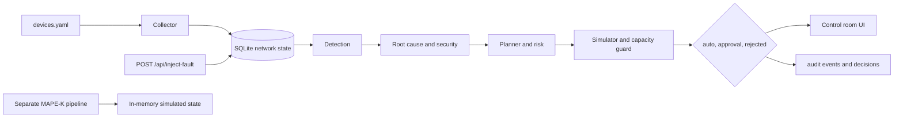

# Architecture
## Stages and actual files
1. Telemetry — `backend/app/collector.py`, `backend/devices.yaml`.
2. Network state — SQLite `backend/netops.db`: `devices`, `telemetry_history`, `incidents`.
3. Detection — `backend/app/detection.py`: EWMA plus z-score plus sustained window.
4. Root cause — `backend/app/rca.py`: central-overload rule, downstream symptoms.
5. Security — `rca.classify_security`: scan signature and request-rate check.
6. Action planner — `backend/app/planner.py`: `plan` plus `risk_score`.
7. Simulation — `planner.simulate` with capacity guard.
8. Decision — `planner.decide`: `auto`, `approval`, or `rejected`, persisted.
9. Response and UI — `backend/app/api.py` plus `frontend/src/main.js`: simulate and record a decision. API decisions do not invoke the MAPE-K executor.
10. Simulated apply — `backend/app/executor.py` through `backend/app/pipeline.py`: changes only in-memory demo state using a safe no-op device adapter. It does not connect to a device.

## Data flow



## Request flow

```text
Vite UI on port 5173 calls the Python API on port 8000, which reads SQLite netops.db.
```

## Design decisions
- Standard library backend for portability and easy marking.
- Explicit thresholds instead of opaque models.
- Simulation is mandatory before any approval, and irreversible actions are never auto-approved.
- Both response paths are simulation-only; no network-device adapter or device-changing API is provided.
- Reversible actions retain snapshots needed for rollback, including both endpoints of a simulated failover.
- Every automated conclusion is stored with its reason.
